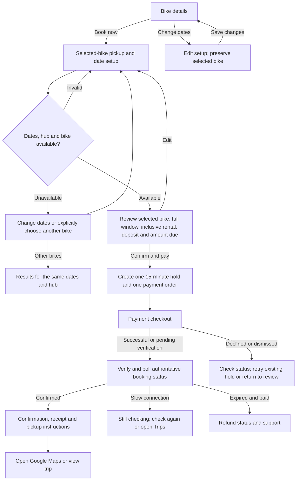
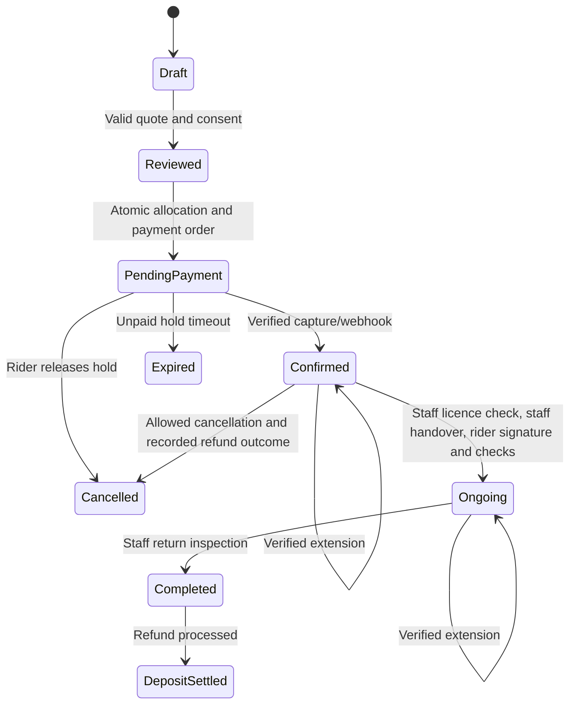

# Valley Ride operational flows and booking design

Owner decisions, 25 October 2026:

- Listed rates already include 18% GST. An Activa day is ₹649, including ₹99 GST; a ₹2,000 refundable deposit makes the payment ₹2,649. Tax is extracted for accounting and never added again. Listed one-way, extra-km and late-hour rates follow the same inclusive convention.
- Admins may make their own rentals. Customer endpoints still enforce booking/document ownership; an admin's personal booking flow must not expose another rider's records.
- Customers may reserve bikes at their pickup hub. Inventory is not a fleet-wide dispatch pool. A one-way trip must not strand a unit needed for a later reservation.
- The bike-first flow is bike details → Book now → pickup/return and dates → review → payment → confirmed booking → Google Maps pickup directions. The chosen bike must survive every step.
- Refundable deposits are separate from rental cost, disclosed before checkout, and not subject to added GST. Existing stored payment amounts are not rewritten by deployment.

This is the implementation/acceptance working document. A control responding to a tap is not sufficient evidence that the complete operation works. Native payment, camera/signature and push delivery checks are recorded separately from browser and API tests.

## Bike-first booking

| Step | Required state and action | Contract and recovery |
| --- | --- | --- |
| Bike details | Selected model is explicit. Rates say “including GST”; deposit and total due are visible. Both pickup and return times are shown. | Details remain readable when the current dates are unavailable. Do not silently change the bike. |
| Book now | Open setup for this model. Prefill the last draft; require the rider to continue from the setup. | Never send a selected-bike booking through generic Find rides. |
| Dates/location | All wall-clock choices refer to India time. Return is at least four hours after pickup; billable days are started 24-hour blocks. Show the selected hub's hours. | Missing/past/short/closed-hours input has an inline reason. Pickup and return controls edit the correct endpoint. |
| Offer | Set the minimum duration of the selected offer and refresh the server quote. | An offer changes rental duration; it is not an additional coupon and must not create a hold. |
| Availability | Request the selected hub, return hub, window and model. Check the same rules again when creating the booking. | Do not show a unit at another hub. A race produces an availability error with preserved choices. |
| Review | Show the same model and full pickup/return date-times. Show listed rental, discounts, included GST, refundable deposit and exact amount due. | Repricing disables payment. Invalid coupons show their own error. Editing preserves the chosen bike. |
| Pay | Send the reviewed expected amount and a stable idempotency key for this draft/attempt. | A changed price returns to review for consent. An ambiguous network failure must not create another hold or payment order. |
| Confirmation | Render success only from server-confirmed state, not just an SDK callback. | Pending/slow verification has Check again and Trips. Never assert “not charged” when a payment is still uncertain. |
| Pickup directions | Show the booking's actual pickup point, address, hours and contact. | Use Google Maps universal directions with coordinates when configured, otherwise the recorded address. A failed launch leaves the address and Call desk available. |

## Date-first and authentication paths

| Operation | Screen flow | Required preservation |
| --- | --- | --- |
| Search by dates | Explore/home → pickup/return setup → Find rides → filtered results → bike details → Book now → selected-bike setup → review | Hub, window and return choice persist. Category/sort change the displayed list, not the booking draft. |
| Website guest booking | Public bike/search → selection → login/register when a private action is required → selected bike/window → review | Carry selected model and dates through the safe return URL/draft. No default-date reset after login. No automatic charge after login. |
| Mobile login/register | Welcome → phone/password → profile details if registering → Explore or saved intended destination | Keyboard can be dismissed; Next reaches password. Failed login preserves inputs; no password is logged or embedded. |
| Session expiry | Private action → refresh once → retry, or login with saved intent | Keep a draft across authentication. Offline failures must not destroy a valid saved session. |
| Logout/account switch | Profile → Log out → Welcome | Revoke tokens and clear private caches/drafts that belong to the previous user. |

## Booking and money state machine

Money rules:

1. `pricePerDayPaise` and displayed extra/one-way/late rates are GST-inclusive. Duration and coupon discounts are calculated against inclusive rates. Server quote remains the authority.
2. Existing accounting fields (`rentalPaise`, `discountPaise`, `feesPaise`, `taxPaise`) retain their net/tax meanings so stored bookings and invoices remain interpretable. The quote also provides explicit inclusive presentation fields. Sum of net components plus included tax must equal the inclusive total to the paise.
3. Only the refundable deposit is added to the inclusive trip total. Booking, SDK order, capture verification, receipt and cancellation/refund amounts must agree.
4. Review-to-payment price drift requires fresh consent. The client cannot override a price by sending a smaller expected amount.
5. Scope idempotency by user, operation and resource; bind it to the request body. Disconnection does not make an in-flight money operation safe to repeat as a new operation.
6. A successful SDK callback starts verification. Backend capture/webhook processing decides confirmation, handles duplicate events and refunds captures that arrive after a hold was lost.
7. Extension review shows old return, new return, full revised rental, already paid and incremental amount. No extension is shown as completed before the server applies it.
8. Return deductions use inclusive extra/late prices and recorded damage. The user sees the inspection and refund/owed result. A pending refund is not labelled settled.

## Inventory and hub rules

- A new unit starts at its home hub. Track current hub separately from home hub; backfill existing units from their most recent recorded return, falling back to home.
- Allocation requires an ACTIVE unit at the chosen pickup hub with no overlapping active reservation. Overdue ONGOING units cannot become “free” just because their planned end passed.
- Account for preceding planned one-way returns and the pickup hub required by the next reservation. Reject a proposed one-way move that would make an existing later pickup impossible.
- Actual staff return moves current hub to the booking's return point in the same transaction as the recorded return. No customer can move inventory by changing a client-side ID.
- Admin relocation is explicit, validated against ongoing/upcoming reservations and audited. Marking a unit retired/maintenance does not make it available; show affected bookings and errors.
- Availability and allocation share one predicate. Row locks plus the exclusion constraint remain the final protection against simultaneous double booking.

## Rider operations after booking

| Operation | Screens and actions | Success and failure behavior |
| --- | --- | --- |
| Find/resume booking | Trips → Upcoming/Past → trip detail | Show loading/error/empty separately. Pending payment resumes the existing booking/order, not a new booking. |
| Documents | Profile/trip checklist → Documents → choose type → photo/upload → submit → review status | Load existing documents before showing replacement forms. Preserve a draft after denied permissions, picker cancel, failed upload or failed submit. Never claim saved documents are absent after a request failure. |
| Pickup | Confirmed trip → Google Maps/Call desk → staff records handover → rider agreement/signature → condition checklist → emergency contact → Start ride | Require the correct booking owner and a staff handover with licence check. A missing staff handover explains the next action. Do not allow payment/confirmation to bypass pickup checks. |
| On the road | Ongoing trip → due time, directions, desk/roadside help | Show return hub for a one-way trip. External-link failure leaves address/contact available. |
| Extend | Trip → choose later return → availability and incremental quote → pay if needed → trip with revised return | Retain original return on failure. Conflicting or late payment is handled by backend refund logic, with a visible result. |
| Cancel/release | Trip → cancellation/refund preview → confirm or keep booking → Trips/refund status | Preserve cancellation policy and disclose the amount before confirmation. Use one idempotent operation; distinguish pending/failed/processed refund. |
| Return/refund | Staff completes return → rider summary → deductions → deposit tracker → receipt | Display actual recorded km, late hours, damage and balance. No fabricated settled status. |
| Receipt/history | Trip or Payments → receipt → share/download | Use stored accounting amounts. Tax components sum to the rental total; deposit is separate. No placeholders presented as legal registration details. |
| Review/rebook | Completed trip → rating/tags/comment → submit → thank you; Book again → new draft | Existing review load failure is recoverable. Rebooking starts a new, explicitly reviewed operation. |
| Profile/password/help | Profile → edit/save or password change; Help → FAQ/desk/WhatsApp; Notifications → related trip/document | Save feedback and retry are visible. Password changes retain this session and revoke others as designed. Links land on the relevant owned record. |

## Admin and desk operations

| Operation | Screen sequence | Guards and side effects |
| --- | --- | --- |
| Add/manage unit | Fleet → Add vehicle → model/registration/home/odometer/purchase → save → unit details/documents | Admin only for inventory changes. Disable duplicate writes, validate required options and registration, surface failures. Home and current hub are distinct. |
| Maintain/retire/relocate | Fleet/unit → requested change → affected reservation check → save/audit | Do not count retired units as available. Prevent impossible ongoing/future pickups. |
| Booking calendar | Calendar → previous/next week or Today → booking detail | India-time boundaries; correct event spans and links. Filters change presentation without altering a booking. |
| KYC review | Customers/documents → queue/status → document → approve or reject with reason | Staff/admin role and private file access. A failed queue load is not an empty queue; no repeated approve/reject while a write is pending. |
| Pickup desk | Pickups → booking → verify customer/unit → odometer/photos/licence check → save handover → rider signs | Correct status transition and ownership. Record evidence before allowing rider start. |
| Return desk | Returns → booking → odometer/checklist/photos/damage → inclusive deduction preview → complete → refund status | No double completion/refund. Current hub updates with the return. Failed/pending provider refund remains visible for staff follow-up. |
| Pricing/coupons | Pricing → edit inclusive day/extra rates or duration/season rule → save; Coupons → create/disable | New quotes use the rule. Existing stored payments are not silently repriced. Coupon preview uses inclusive amounts; invalid input has feedback. |
| Finance/export | Finance → month → P&L/CSV; booking → payment/invoice history | Revenue reports may show net revenue and GST separately; that is accounting, not an added customer charge. Failed loads and exports need recovery. |
| Content/pickup points | Content → guide/location → edit → preview/save | Validate required content, active hub, hours and coordinates. Do not invent exact physical pickup coordinates. |
| Admin personal rental | Rider app/site → same booking flow as a customer → own trip | Explicit owner-approved capability. It does not grant generic customer endpoints access to another user's bookings/documents. |
| Capital | Public calculator and legally gated portal/onboarding | Preserve the existing closed-to-investment gate; do not make financial commitments as part of rental-flow work. |

## Acceptance matrix

Test complete operations and invariants, with a real isolated PostgreSQL/Redis API stack where feasible, and mock payment transport. Do not run destructive integration setup or simulated payments against production.

- Bike-first one-day Activa: select model → dates → review ₹649 inclusive + ₹2,000 deposit → payment order ₹2,649 → confirmed → correct Google Maps pickup destination.
- Date-first search, each offer threshold, same-day four-hour minimum, 24/25-hour boundary, month boundary, India/device time-zone differences, one-way fee and return-hub directions.
- Coupon apply/remove/expired, seasonal rate, price change after review, unavailable model, another-hub inventory, retired/maintenance/overdue units and reservation races.
- Lost create response, repeated taps/retries, user/body/resource idempotency scope, SDK dismissal, delayed/duplicate capture, expired hold and late-payment refund.
- Guest login preserves bike/window; admin can book their own ride but cannot read another rider's record; blocked/deleted/expired sessions cannot complete private operations.
- KYC load/upload/permission failures, staff handover, signature/condition/emergency-contact guards, extension conflict, cancellation, return deductions/refund, receipt and review.
- Every operation: loading, empty, validation, offline/API failure, retry, back/cancel, successful completion and re-entry from Trips or notifications.

Native UPI handoff, camera/signature, VoiceOver/TalkBack and push delivery need actual device/service verification. Store-release privacy/account-deletion gates are tracked separately; a successful UI walkthrough or archive is not evidence that those are complete.

## Research used

These inform interaction choices, not Valley Ride's business or refund policies:

- [Turo — finding a vehicle](https://help.turo.com/finding-a-vehicle-for-your-trip-HyGZXYebx) and [pickup/return selection](https://help.turo.com/choosing-delivery-for-your-trip-SJRZ4Eg45): preserve trip context and make trip changes explicit.
- [Zymo booking guide](https://zymo.app/book): disclose vehicle, price, included km, deposit and pickup context while choosing a vehicle.
- [Nielsen Norman Group — taxes and fees](https://www.nngroup.com/articles/ecommerce-taxes-fees/) and [progressive disclosure](https://www.nngroup.com/articles/progressive-disclosure/): disclose material costs before commitment and show information at the stage that needs it.
- [Google Maps URL documentation](https://developers.google.com/maps/documentation/urls/get-started): one encoded universal directions URL with `api=1` and the recorded destination, with browser fallback.
- [CBIC CGST Rules, Rule 35](https://cbic-gst.gov.in/pdf/01062021-CGST-Rules-2017-Part-A-Rules.pdf): extract included tax from an inclusive amount. The 18% rate and inclusive-price business convention here come from the owner.
